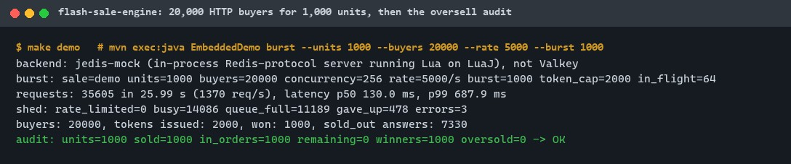
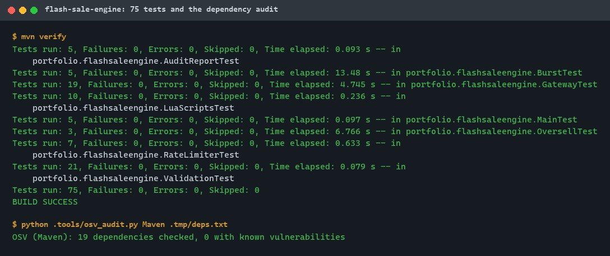
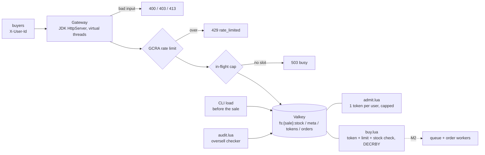
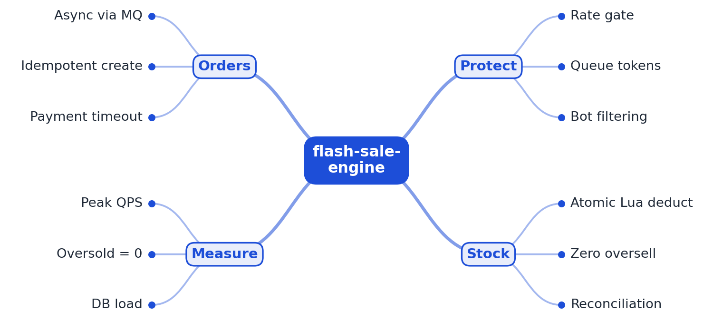

# flash-sale-engine

[](https://github.com/EquinoxWN/flash-sale-engine/actions/workflows/ci.yml)


> The stock side of a flash sale: stock preloaded into Valkey, a gateway that sheds the crowd with a rate limit, an in-flight cap and capped queue tokens, and one atomic Lua script per purchase, so concurrent buyers can never oversell.

Part of my **Backend and API** list · Java 21

## Proof it works

20,000 HTTP buyers compete for 1,000 units through the gateway. Exactly 1,000 win, stock ends at 0, the audit finds 0 oversold units, and only 2,000 buyers (the token cap) ever reach the purchase script:



75 tests (Lua script result codes, 2,000-buyer races, randomized sales, HTTP end to end, rate limiter, CLI) pass, and no dependency has a known vulnerability:



Locally, the backend is jedis-mock (an in-process Redis-protocol server that runs the Lua on LuaJ). CI runs the same tests and the burst against a real Valkey 9.0 container.

## Architecture

**What M1 runs today:**



**Full roadmap (M1 to M3):**



## How it works

_Steps 1 and 2 are built and tested (M1); the rest is on the [roadmap](#roadmap)._

1. Before the sale, stock is loaded into Valkey, and the gateway sheds excess traffic with rate limits and queue tokens.
2. A Lua script checks and decrements stock atomically in Valkey, so thousands of concurrent buyers can never oversell.
3. Winners get a message on a queue, and order workers write to the database at a pace it can sustain.
4. Order creation is idempotent per user and item, so retries and duplicate messages never create two orders.
5. Unpaid orders expire and return stock, and a reconciliation job compares Valkey, queue and database.
6. k6 fires a burst of 50k virtual users, and the checker verifies units sold never exceed stock.

In M1 a purchase is two calls. `POST /sales/{id}/token` asks `admit.lua` for a queue token: one per user, at most `tokenCap` per sale (default twice the units). `POST /sales/{id}/buy` sends the token to `buy.lua`, which in one script checks the token, the per-user limit and the stock, then decrements the stock and records the order. Valkey runs a script to completion before any other command, so no buyer can slip in between the check and the decrement. Before Valkey is called at all, the gateway refuses malformed requests, applies a lock-free GCRA rate limit (429) and caps requests in flight (503).

## Who it helps

- **Who:** Backend engineers building a flash sale, ticket drop or limited-stock launch, and people preparing for the "design a flash sale" interview question.
- **The problem:** A read-check-write on stock from many application threads oversells the last units, and letting the whole crowd through to the store or database takes the shop down.
- **How to use it:** Load a sale with `load`, run the gateway with `serve`, point buyers at the two routes, and run `audit` afterwards to prove no unit was oversold. `burst` (or `make demo` without Valkey) shows the whole flow under load on your machine. The Lua scripts in [`src/main/resources/lua/`](src/main/resources/lua) can be copied into another service as they are.

## Tech stack

| Area | In M1 | Planned |
|---|---|---|
| Core | Java 21, JDK `HttpServer` on virtual threads, GCRA rate limiter, Jedis 8 | Spring Boot if M2's queue and database need it |
| Hot path | Valkey Lua scripts: load, admit (queue tokens), buy (atomic stock deduction), status, audit | Stock buckets across keys |
| Orders | - | RocketMQ or Kafka, order workers, MySQL / PostgreSQL, idempotent create |
| Test | JUnit 6, jedis-mock locally, Valkey 9.0 container in CI, in-process HTTP burst, oversell audit | k6 burst of 50k virtual users, reconciliation job |

Language: **Java 21**. Code in `src/main/java/portfolio/flashsaleengine/`, Lua in `src/main/resources/lua/`.

## Run it

**Prerequisites:** JDK 21+ and Maven 3.9+. A Valkey (or Redis-compatible) server only for `serve`, `burst` and the real-Valkey tests; the tests and `make demo` run without one.

```bash
make setup   # resolve dependencies
make lint    # palantir-java-format check, compile with -Xlint:all -Werror
make test    # 75 tests on jedis-mock (about a minute); set VALKEY_URL to add real-Valkey cases
make demo    # 20,000 HTTP buyers for 1,000 units on jedis-mock, then the audit
make audit   # OSV-Scanner on a CycloneDX SBOM (as in CI)
```

Against a real Valkey (for example `docker run -p 6379:6379 valkey/valkey:9.0-alpine`), using the CLI (`mvn -q compile exec:java -Dexec.mainClass=portfolio.flashsaleengine.Main -Dexec.args="..."`):

```text
load   --sale spring-drop --units 1000 [--token-cap 2000] [--per-user 1] [--ttl 86400] [--force]
serve  --port 8080 [--bind 127.0.0.1] [--rate 5000] [--burst 1000] [--max-in-flight 64]
status --sale spring-drop
audit  --sale spring-drop            # exit 1 if anything was oversold
burst  --sale spring-drop --units 1000 --buyers 20000   # load, in-process gateway, buyers, audit
```

The Valkey URL comes from `--valkey`, else `VALKEY_URL`, else `redis://127.0.0.1:6379` (`redis://` only; TLS is not supported in M1).

```bash
curl -s -X POST -H 'X-User-Id: alice' localhost:8080/sales/spring-drop/token
# {"token":"5f0c...e1"}
curl -s -X POST -H 'X-User-Id: alice' -H 'X-Queue-Token: 5f0c...e1' localhost:8080/sales/spring-drop/buy
# {"result":"won","remaining":999}
```

| Answer | Meaning |
|---|---|
| 200 | token issued (same token on retry), or purchase won |
| 400 / 403 / 413 | bad sale id, user id or quantity / missing or foreign token / request body sent |
| 404 / 405 | sale not loaded or unknown route / wrong method |
| 409 | per-user limit reached, or fewer units left than requested |
| 410 | sold out |
| 429 | `rate_limited` (gateway) or `queue_full` (token cap), with `Retry-After: 1` |
| 503 | `busy` (no in-flight slot) or `store_unavailable`, with `Retry-After: 1`; only `busy` proves the purchase did not run, so the burst client retries `busy` and never `store_unavailable` |

M1 trusts the `X-User-Id` header: put an authenticating proxy in front of the gateway.

## Tests and results

Full numbers, commands and the mutation check: [docs/results/m1.md](docs/results/m1.md). Quality check of the 10 engineering rules, with a mutation test of the core functions: [docs/quality/2026-11-01.md](docs/quality/2026-11-01.md).

| Check | Result |
|---|---|
| Tests (`make test`, jedis-mock) | **75 passed**, 0 failed (13 more real-Valkey cases run in CI) |
| Lint | palantir-java-format clean, `-Xlint:all -Werror` no warnings |
| 2,000 concurrent buyers, 100 units | exactly 100 winners, stock 0, audit clean |
| 25 seeded random sales | never oversold, tokens never above the cap |
| Negative control | read-then-write in Java oversells by 7 (8 buyers, 1 unit); the audit catches it |
| Mutation check | stock checks removed from `buy.lua`: 6 of 70 tests fail |
| Burst demo (jedis-mock) | 20,000 buyers, 1,000 units: 1,000 won, oversold 0; 2,000 tokens, 11,189 `queue_full`, 14,086 `busy` shed |
| Dependency audit | OSV: 19 dependencies, 0 with known vulnerabilities |

The burst ran at about 1,370 requests per second (p50 130 ms) because jedis-mock runs every script on LuaJ inside the test JVM on a shared laptop; those are not Valkey numbers. Valkey throughput is not measured yet.

| Test class | Tests | What it proves |
|---|---|---|
| `LuaScriptsTest` | 10 | Every result code of load, admit, buy, status and audit; TTLs; `NOSCRIPT` fallback |
| `OversellTest` | 3 | 2,000-buyer race, 25 random sales, and the non-atomic negative control |
| `BurstTest` | 4 | 5,000 HTTP buyers sell out exactly; a tight rate limit sheds but never oversells; CLI `burst` |
| `GatewayTest` | 19 | Routes, exact JSON, 13 malformed requests, 413 for bodies, 429 rate limit, 503 busy and store down |
| `RateLimiterTest` | 6 | Burst, refill, long-run rate, no burst growth when idle, 64 threads never exceed the burst |
| `MainTest` | 5 | CLI output and exit codes |
| `ValidationTest` | 18 | Id rules, hash-tagged keys, config bounds, script loading |
| `AuditReportTest` | 5 | Each oversell invariant fails on its own |

Verified only in CI: the real-Valkey cases of `LuaScriptsTest`, `OversellTest` and `BurstTest`, and `make burst` (20,000 buyers against Valkey 9.0, fails the job unless the audit passes; result as a `::notice`).

## Roadmap

**M1** (≈8 h)
- [x] Write `docs/rfc/0001-design.md`: problem, goals, non-goals, chosen design
- [x] Before the sale, stock is loaded into Valkey, and the gateway sheds excess traffic with rate limits and queue tokens.
- [x] A Lua script checks and decrements stock atomically in Valkey, so thousands of concurrent buyers can never oversell.

**M2** (≈8 h)
- [ ] Winners get a message on a queue, and order workers write to the database at a pace it can sustain.
- [ ] Order creation is idempotent per user and item, so retries and duplicate messages never create two orders.

**M3** (≈9 h)
- [ ] Unpaid orders expire and return stock, and a reconciliation job compares Valkey, queue and database.
- [ ] k6 fires a burst of 50k virtual users, and the checker verifies units sold never exceed stock.
- [ ] Publish the proof below with real numbers

## Proof

What this repo must show before it counts as done:

- Peak throughput with zero oversold units and flat database load during the burst.

| Result | Value |
|---|---|
| M3 proof above | Not measured yet (M3). Current M1 numbers: see [Tests and results](#tests-and-results). |

## Why it matters

- **Interview angle:** 'Design a flash sale or ticket booking system', a backend-interview staple in China ('miaosha').
- **Upstream I'd like to contribute to:** Apache RocketMQ (from Alibaba): examples or documentation.

## Design docs

- [RFC 0001: design](docs/rfc/0001-design.md)
- [ADR 0001: record architecture decisions](docs/adr/0001-record-architecture-decisions.md)
- [ADR 0002: take stock only inside one Valkey Lua script](docs/adr/0002-atomic-lua-script-for-stock.md)
- [ADR 0003: JDK HTTP server, jedis-mock locally and real Valkey in CI](docs/adr/0003-jdk-http-server-and-jedis-mock.md)
- [M1 results](docs/results/m1.md)

## Scope

This is a learning and portfolio system, not a hosted production service. Everything runs locally. M1 covers admission and stock only: no authentication, payments, queue or order database yet.

## Security and contributing

- Every GitHub Action is pinned to a commit SHA and the Valkey service image to a digest; workflows run read-only, without persisted credentials.
- Dependabot update pull requests are paused (`open-pull-requests-limit: 0`) so the repository keeps a single `main` branch; dependencies are updated by hand and checked by the CI audit.
- The gateway binds to `127.0.0.1` by default, validates every id against a strict pattern before it reaches a key or a response, refuses request bodies, and bounds work with a rate limit and an in-flight cap.
- Report vulnerabilities privately: see [SECURITY.md](SECURITY.md). To contribute, see [CONTRIBUTING.md](CONTRIBUTING.md).

## License

MIT, see [LICENSE](LICENSE).
